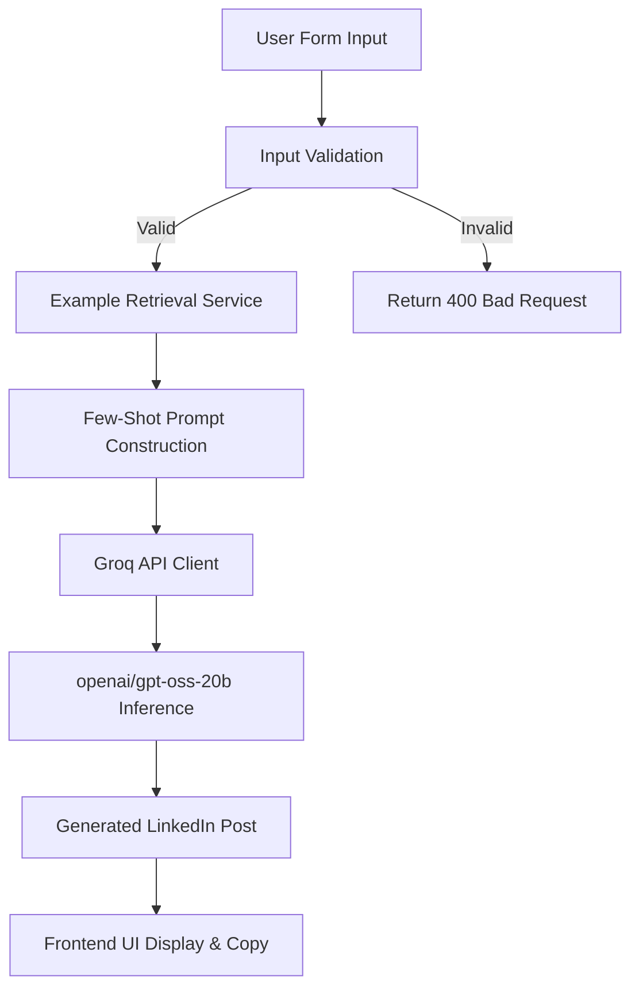

# PostCraft AI — LinkedIn Post Generator (JavaScript GenAI)

A production-grade Generative AI SaaS application for creating high-engagement LinkedIn posts, engineered with **Few-Shot In-Context Learning**, **tag-based style retrieval**, and the **Groq openai/gpt-oss-20b** model.

Featuring a modern, minimal, centered writing interface inspired by premium AI platforms like Jasper and ChatGPT.

---

## 🚀 Key Features

- **Decoupled Architecture**: High-throughput Express.js backend with an ultra-lightweight Vanilla JS frontend.
- **Centered Input Composer**: Large search/composer textarea with instant topic suggestion chips (Career Advice, AI, Job Search, Leadership, etc.).
- **Output Displayed Below Composer**: Generated posts appear directly beneath the input card with automatic smooth scrolling.
- **Preserved Few-Shot Prompting**: Intelligently searches the curated LinkedIn dataset for style and tone exemplars matching the selected topic, post length, and language, injecting up to 2 examples into the prompt.
- **Groq API & openai/gpt-oss-20b**: Ultra-fast inference using Groq's LPU-powered `openai/gpt-oss-20b` model.
- **Multilingual & Multi-Format Support**:
  - **Languages**: English, Hinglish, and Hindi.
  - **Lengths**: Short (1 to 5 lines), Medium (6 to 10 lines), and Long (11 to 15 lines).
  - **Tones**: Professional, Conversational, Inspirational, and Thought Leadership.
- **Zero-Bloat GenAI Stack**: Uses structured JSON dataset storage and in-memory indexing; no unnecessary MongoDB or MERN overhead.
- **Interactive Actions**: One-click copy to clipboard with visual feedback, regenerate with 1-click, and clear.

---

## 🛠️ Technology Stack

| Layer | Technologies |
| :--- | :--- |
| **Backend** | Node.js (v20+), Express.js (v4), ES Modules |
| **LLM Inference** | Groq SDK (`groq-sdk`), Model: `openai/gpt-oss-20b` |
| **Data Storage** | Native JSON (`backend/data/example_posts.json`) |
| **Frontend** | Semantic HTML5, CSS3 Custom Properties & Grid, Vanilla JavaScript (ES6+) |
| **Configuration** | `dotenv` environment variable management |
| **Testing** | Node.js Native Test Runner (`node:test`, `node:assert`) |

---

## 📂 Project Structure

```
linked-post-generator/
├── backend/
│   ├── config/
│   │   └── config.js              # Environment settings and constants
│   ├── controllers/
│   │   └── generateController.js  # Request orchestration and response formatting
│   ├── data/
│   │   └── example_posts.json     # Preserved few-shot dataset with tags & metrics
│   ├── routes/
│   │   └── generateRoutes.js      # REST API route declarations
│   ├── services/
│   │   ├── exampleRetrievalService.js # Tag, language, and line-count categorization
│   │   ├── groqService.js         # Groq SDK client for openai/gpt-oss-20b
│   │   └── promptService.js       # Few-shot prompt formatting & template engine
│   ├── utils/
│   │   └── validators.js          # Input validation and payload sanitization
│   └── server.js                  # Express application setup & static serving
├── frontend/
│   ├── css/
│   │   └── style.css              # Modern GenAI interface styling & glassmorphism
│   ├── js/
│   │   └── app.js                 # Dynamic UI handler, clipboard & API client
│   └── index.html                 # Clean semantic single-page layout
├── tests/
│   ├── api.test.js                # Integration tests for Express routes
│   ├── exampleRetrieval.test.js   # Unit tests for filtering & categorization
│   ├── promptService.test.js      # Unit tests for prompt structure & max 2 examples
│   └── validators.test.js         # Unit tests for payload constraints
├── .env.example                   # Sample environment variable template
├── .gitignore                     # Git ignore rules for node_modules & credentials
├── package.json                   # Dependencies, project metadata, and npm scripts
├── README.md                      # Project overview and quick start guide
```

---

## ⚡ Quick Start

### 1. Prerequisites
- [Node.js](https://nodejs.org/) (version 20 or higher)
- A free [Groq Cloud API Key](https://console.groq.com/keys)

### 2. Installation
Clone the repository and install dependencies:
```bash
npm install
```

### 3. Configure Environment Variables
Copy `.env.example` to `.env`:
```bash
cp .env.example .env
```
Open `.env` and add your Groq API key:
```env
GROQ_API_KEY=gsk_your_actual_groq_api_key_here
GROQ_MODEL=openai/gpt-oss-20b
PORT=5000
```
*(For detailed configuration guidance, see [ENV_SETUP.md](ENV_SETUP.md).)*

### 4. Run the Application
Start the server in production mode:
```bash
npm start
```
Or start in development mode with automatic reload:
```bash
npm run dev
```

Open your browser and navigate to:
```
http://localhost:5000
```

---

## 🧪 Running Tests

The application includes a comprehensive test suite covering input validation, dataset filtering, few-shot prompt construction, and Express API endpoints.

Run tests using Node's native test runner:
```bash
npm test
```

### Test Coverage Highlights:
- **Validators**: Verifies topic length constraints, empty checks, allowed lengths, and language options.
- **Example Retrieval**: Confirms accurate line-count categorization (`<5` = Short, `5-10` = Medium, `>10` = Long) and tag filtering.
- **Prompt Service**: Asserts exact prompt template preservation and strict enforcement of maximum 2 few-shot exemplars.
- **API Endpoints**: Validates health checks, option endpoints, 400 validation responses, and full mocked LLM generation cycles.

---

## 🧠 GenAI Pipeline



1. **User Request**: User chooses topic, length, and language style.
2. **Deterministic Retrieval**: System filters curated posts by matching tags, length tier, and language.
3. **Few-Shot Construction**: Up to 2 relevant posts are formatted as writing-style exemplars.
4. **LPU Inference**: Groq executes low-latency inference with openai/gpt-oss-20b.
5. **Presentation**: The resulting post is formatted in a LinkedIn-styled preview card with one-click copy.

---


